[**Itch.io** <i class="fa-brands fa-itch-io"></i>](https://giruza.itch.io/breathdown) ||| [**GitHub** <i class="fa-brands fa-github"></i>](https://github.com/Jose-AMM/Bubbly_Jam) ||| [**Game Jam** <i class="fa-solid fa-jar"></i>](https://globalgamejam.org/games/2025/breathdown-8)

  <iframe
    frameborder="0"
    src="https://itch.io/embed-upload/12611640?color=a44098"
    allowfullscreen=""
    style="position: absolute; top: 0; left: 0; width: 100%; height: 100%; border: 0;"
  >
    <a href="https://giruza.itch.io/breathdown">Play Breathdown on itch.io</a>
  </iframe>

<iframe frameborder="0" src="https://itch.io/embed/3273017" width="552" height="167"><a href="https://giruza.itch.io/breathdown">Breathdown by Giruza, Yamila Wehbe, Monkwolf Sounds, DarkrimXtrike, cmartinezgom, Franchocratico, Nerea Herreros, Asgardr7</a></iframe>

  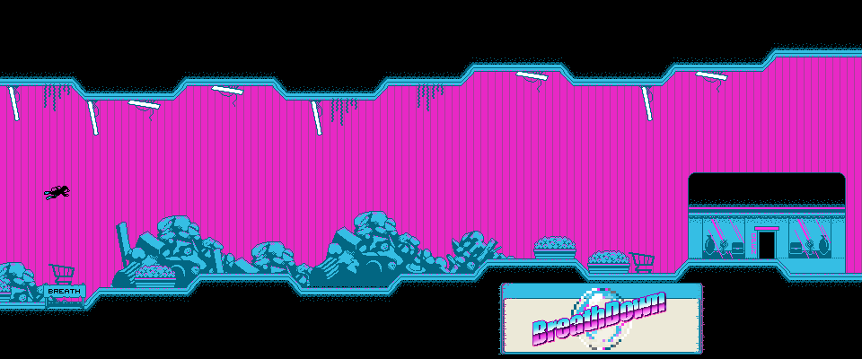

Breathdown is a **2D narrative video game made with Unity**, set in an underwater mall through which the player must dive without drowning to uncover all its secrets.

It was developed in two days at [the Global Game Jam 2025](https://globalgamejam.org/games/2025/breathdown-8) in Madrid, and it was recognised as the **game with the best art of the Jam** at that venue.

I was the **lead programmer and assistant designer**.

The idea behind Breathdown was to create a mysterious and oppressive experience, alternating timed diving sections, in which the player must reach different shops of the sunken mall before running out of oxygen. In each shop, the player meets a mysterious character who asks questions about their goals, their longings, the place or life itself.

With every section completed the difficulty rises and the place becomes more and more "glitchy" and degenerate, clearly affecting the dialogue sections and the shop's enigmatic shopkeeper.

As lead programmer, I defined the tasks and the initial architecture of the game.

My contributions:
- **Dialogue System**: real-time text effects such as waving, shaking, bouncing, rotating, fading, rainbow and red/blue colors, bold and italic text, and even a creepy smile that appears inside the text.
- Implementation of the dialogue system, its UI and its options in the shop scenes.
- **Branching dialogue**: a choices tracker remembers the player's answers, and later shops pick their dialogue based on the earlier choices.
- **Shop setup**: built the shop scenes and their dialogue UI for all four shops, importing the shop sprites and wiring up each shop's dialogues.
- Main and options menus, with the animated transition into the game.
- Transitions and black-screen fades.
- Audio Manager and import of music and sound effects.
- Sprite import and palette creation for the tilemaps.
- **Visual setup**: created the mall ground palette, set up the TextMesh Pro fonts and materials, and added 2D lights to the props and VFX to the player.
- Particle systems, such as the bubbles and the fish.
- **Glitch and floating scripts**: the sprite and UI glitch animations that make the place degrade, and the floating movement that keeps the diver bobbing in the water while idle.
- General testing and code review of my teammates' code.

Although my main role was programming, I also helped with design: I proposed the initial idea of the underwater mall with several shops to visit, the oxygen mechanic, the level design, the difficulty curve, and several quality-of-life improvements such as the crosshair on the player's movement.

Want a taste before playing? Here is the game in action (captured from the real game):

**A retro-OS style menu with Main, Options and Credits tabs**

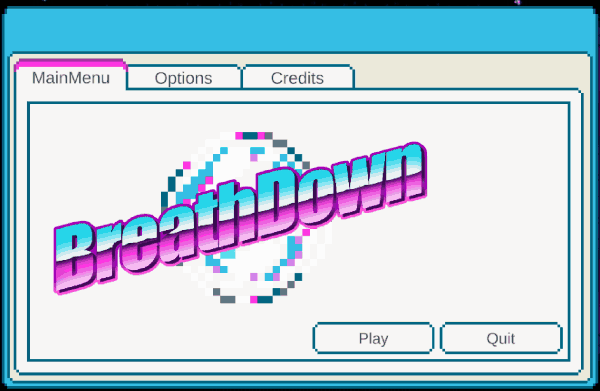

**Pressing Play: the menu window floats away and the diver, the bubbles and the small fish take over**

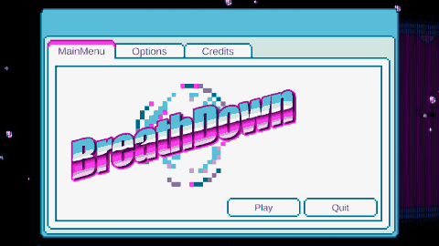

**Swimming through the mall: aim with the mouse and boost with click or space**

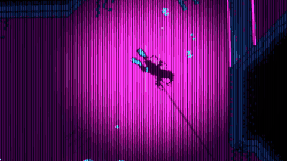

**Your oxygen is a row of bubbles: they pop one by one until you drown and respawn**

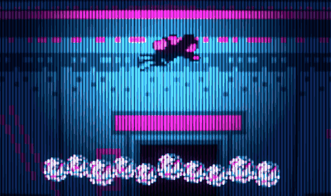

**Every door leads to a shop, where the Merchant talks to you with animated text and choices**

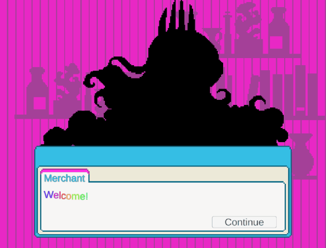

**Shop after shop, the place degrades: cobwebs, glitching windows and a changing Merchant**

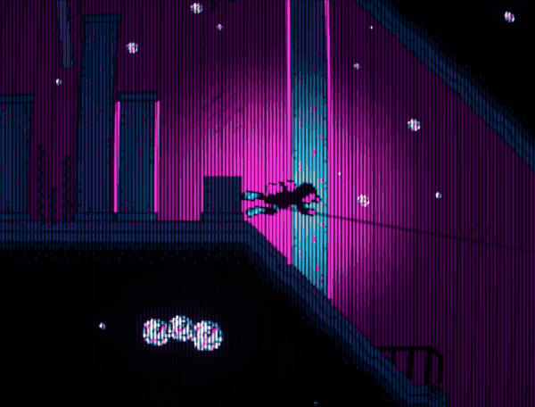

**The glitches spread across the screen and into the dialogue window (spoiler!)**

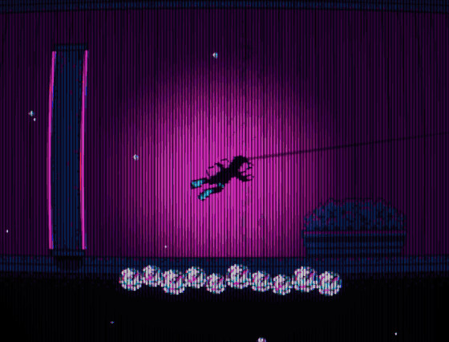

**The last shop (spoiler!)**

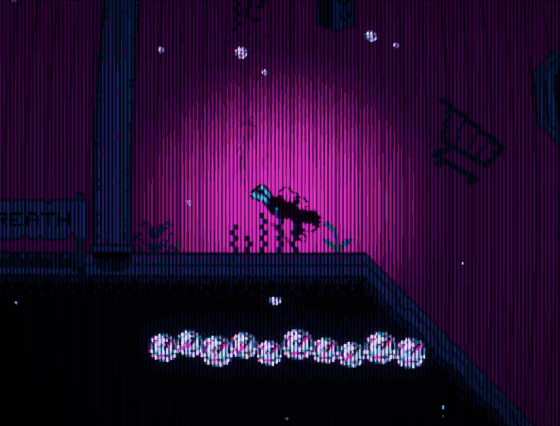

**Branching dialogue: the same shop says different things depending on your earlier choice (left: answered A in the first shop, right: answered B)**

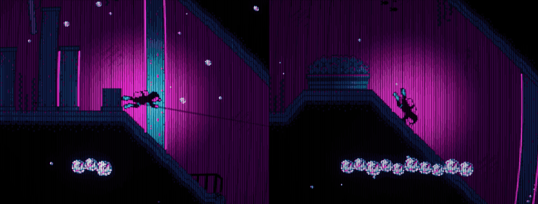

**A close-up of the Merchant glitching (spoiler!)**

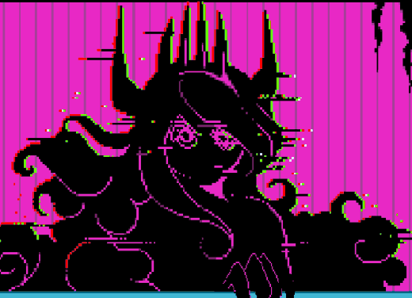

**The four shops, each with its own dialogue, choices and text effects**

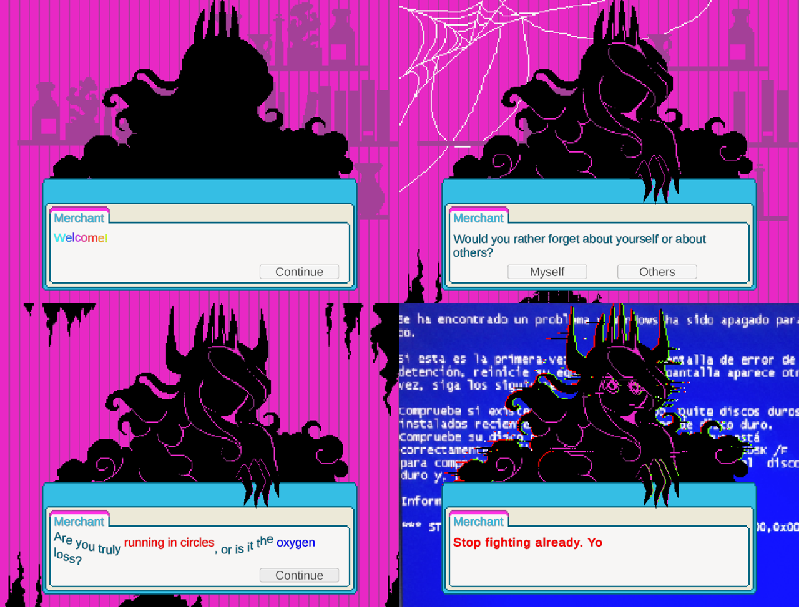

**The four levels, from the first to the last**

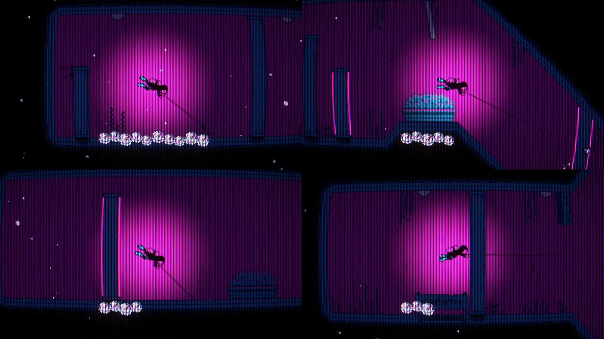

And some screenshots:


