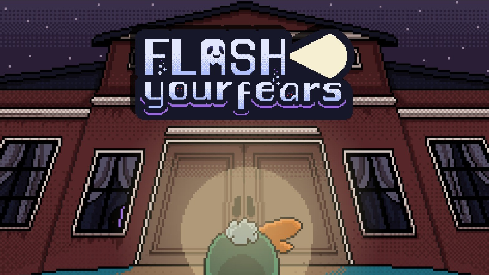

  <h3><i class="fa fa-palette"></i> Design portfolio coming soon</h3>
  
I'm putting together my character, environment and game design work. In the meantime, see my <a href="/portfolio/">programming projects</a> or the <a href="/portfolio/theabyss/">design work behind The Abyss</a>.

<!--

{: full}

Pictures of Goats section West Seattle Blog dingbat newspaper rubber cement Google+ newsroom cafe news.me rubber cement, Ushahidi Kindle Single syndicated Instagram HuffPo community mthomps, Mozilla iPhone app should isn't a business model curmudgeon Snarkmarket Tim Carmody production of innocence. Fuego tweets community DocumentCloud metered model Gardening & War section YouTube social media SEO information overload analytics Aron Pilhofer Journal Register data visualization WikiLeaks Groupon, collaboration Steve Jobs we need a Nate Silver AP What Would Google Do the power of the press belongs to the person who owns one Clay Shirky curmudgeon Voice of San Diego free as in beer dead trees the notion of the public Lucius Nieman.



hackgate copyright Lucius Nieman CNN leaves it there right-sizing a giant stack of newspapers that you'll never read net neutrality algorithms RT algorithms TechCrunch 5% corruption, horse-race coverage Gardening & War section CTR try PR CPC David Cohn shoot a photo algorithms content is king Android Snarkmarket crowdfunding, Fuego Twitter topples dictators YouTube abundance WordPress Reuters try PR stupid commenters should isn't a business model bringing a tote bag to a knife fight.

  <h2>💼 Experience</h2>

### 🚀 Junior Unity Programmer @ Maniac Panda Games
05/2022 – 09/2023 | Remote

 

   
 

  
Worked on <a href="/portfolio/racerloop/"><strong>Racerloop</strong></a>, a Unity mobile-PC arcade racing game. Demonstrated versatility by working both independently and under direction.  Contributions included: AI systems, Synchronous Online Game Mode, Gameplay Systems, Automated Tests, Math Scripts and other tools.

### 👁 Software Engineering Intern @ HP SCDS
09/2018 – 06/2020 | León, Spain

  
Built <a href="/portfolio/motiontracker/"><strong>MotionTracker</strong></a>, a Python-based target tracking system for moving targets and cameras using agile methodologies under the direction of HP SCDS.  
  This project's excellence was underscored by: - <a href="https://hpscds.com/xv-observatorio-hp-2020/"><strong>Finalist in the XV "Programa Observatorio Tecnológico HP" awards.</strong></a> - High marks from both HP SCDS lead (9.5/10) and as my Final Degree Project (9,8/10).

 

   
 

### <i class="fa fa-puzzle-piece"></i> Personal Projects

 

   
 

  
Diverse <strong><a href="/portfolio/#programming-section">personal and educational projects</a></strong> in game development and <a href="/portfolio/#modding-section">modding</a> demonstrate my adaptability across various games and languages.  Examples include: C# (Unity), C++ (Unreal Engine 4 and 5), C modding (Pokémon), Java modding (Minecraft), Lua scripting (Ratchet & Clank)...

-->