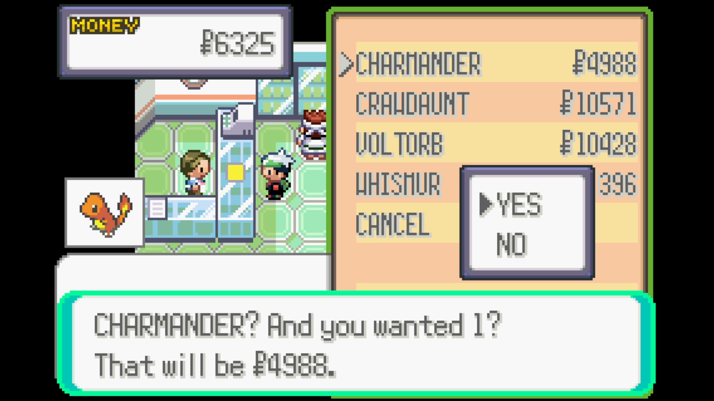
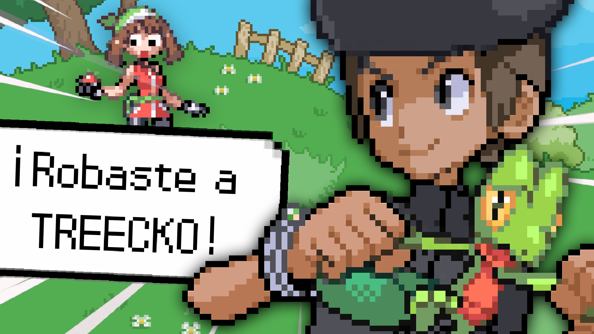
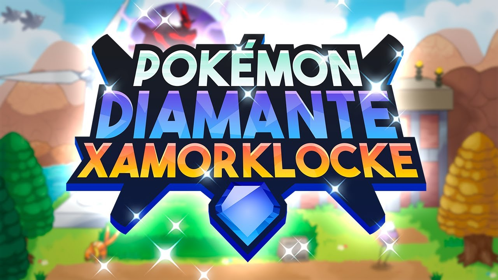
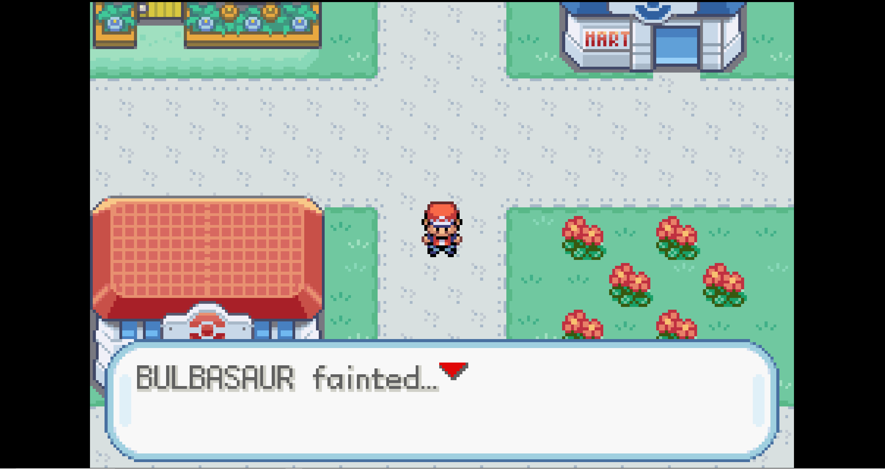
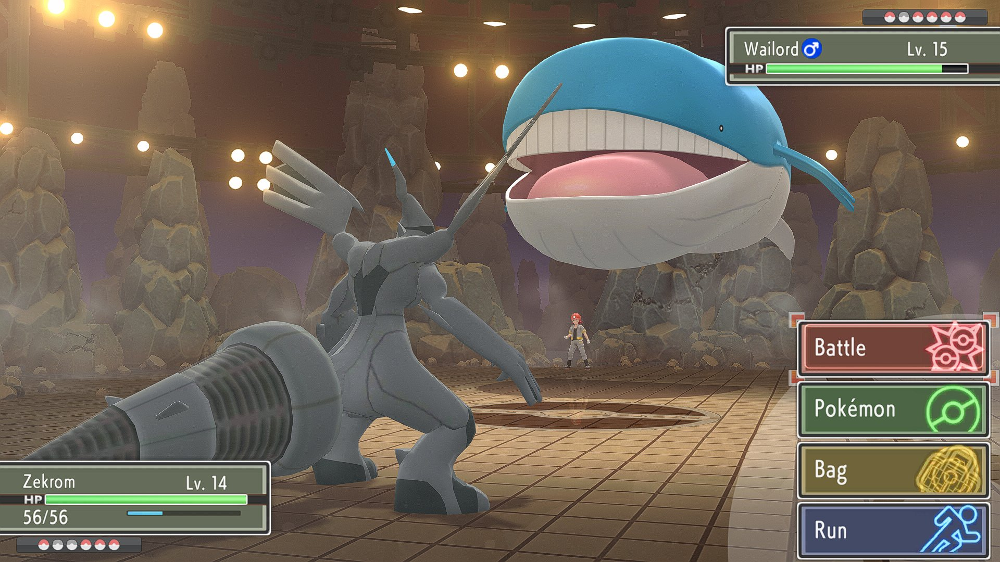

### <i class="fa fa-bolt"></i> Pokémon Emerald, but everything is an Egg

<!-- Section 1: Image and Basic Info -->

  <!-- Mod Image -->
  

    
  

  <!-- Mod Details (Short Summary) -->
  

    
<strong><i class="fa fa-gamepad"></i> Game:</strong> Pokémon Emerald

    
<strong><i class="fa fa-code"></i> Language/Tools:</strong> C + Decompilation

    
<strong>Summary:</strong> 
    In this mod for Pokémon Emerald, all Pokémon show up as Eggs and you only know their Type and color before opening them. Comissioned for the YouTuber Andros.
    

  

<!-- Section 2: Key Features List -->

  
<strong>Key Features:</strong>

  <ul style="margin-top: 0; padding-left: 20px;">
      <li>Wild Pokémon encounters are disabled; catching is impossible.</li>
      <li>Poké Marts now sell Pokémon instead of items, with stock varying by location. The UI has been modified to show each Pokémon name, prize and icon.</li>
      <li>Players can sell Pokémon from their PC storage at half their calculated purchase price.</li>
      <li>A custom formula determines Pokémon prices based on stats, rarity, and other factors.</li>
      <li>Shop inventories are randomized per save file but remain consistent within that playthrough.</li>
      <li>Shop Pokémon's levels and prices will update depending on the player's current badges.</li>
      <li>The party menu includes an option to nickname Pokémon directly.</li>
  </ul>

### <i class="fa fa-bolt"></i> Pokémon Ash Battles

<!-- Section 1: Image and Basic Info -->

  <!-- Mod Image -->
  

    
  

  <!-- Mod Details (Short Summary) -->
  

    
<strong><i class="fa fa-gamepad"></i> Game:</strong> Pokémon Emerald

    
<strong><i class="fa fa-code"></i> Language/Tools:</strong> C + Decompilation + Sprite Editing

    
<strong>Summary:</strong> 
    In this mod for Pokémon Emerald, you can battle against Ash in every season of the anime. With custom sprites and teams. Comissioned for the YouTuber Boshtok.
    

  

<!-- Section 2: Key Features List -->

  
<strong>Key Features:</strong>

  <ul style="margin-top: 0; padding-left: 20px;">
      <li>Wild Pokémon encounters are disabled; catching is impossible.</li>
      <li>Poké Marts now sell Pokémon instead of items, with stock varying by location. The UI has been modified to show each Pokémon name, prize and icon.</li>
      <li>Players can sell Pokémon from their PC storage at half their calculated purchase price.</li>
      <li>A custom formula determines Pokémon prices based on stats, rarity, and other factors.</li>
      <li>Shop inventories are randomized per save file but remain consistent within that playthrough.</li>
      <li>Shop Pokémon's levels and prices will update depending on the player's current badges.</li>
      <li>The party menu includes an option to nickname Pokémon directly.</li>
  </ul>

### <i class="fa fa-gun"></i> Pokémon Russian Roulette

<!-- Section 1: Image and Basic Info -->

  <!-- Mod Image -->
  

    
  

  <!-- Mod Details (Short Summary) -->
  

    
<strong><i class="fa fa-gamepad"></i> Game:</strong> Pokémon Emerald

    
<strong><i class="fa fa-code"></i> Language/Tools:</strong> C + Decompilation 

    
<strong>Summary:</strong> 
    In this mod for Pokémon Emerald, every time you win a trainer battle, a randomly selected Pokémon of your team dies. Comissioned for the YouTuber KodiDre.
    

  

<!-- Section 2: Key Features List -->

  
<strong>Key Features:</strong>

  <ul style="margin-top: 0; padding-left: 20px;">
      <li>Wild Pokémon encounters are disabled; catching is impossible.</li>
      <li>Poké Marts now sell Pokémon instead of items, with stock varying by location. The UI has been modified to show each Pokémon name, prize and icon.</li>
      <li>Players can sell Pokémon from their PC storage at half their calculated purchase price.</li>
      <li>A custom formula determines Pokémon prices based on stats, rarity, and other factors.</li>
      <li>Shop inventories are randomized per save file but remain consistent within that playthrough.</li>
      <li>Shop Pokémon's levels and prices will update depending on the player's current badges.</li>
      <li>The party menu includes an option to nickname Pokémon directly.</li>
  </ul>

### <i class="fa fa-money-check-dollar"></i> Pokémon Emerald, but you can only BUY Pokémon

<!-- Section 1: Image and Basic Info -->

  <!-- Mod Image -->
  

    
  

  <!-- Mod Details (Short Summary) -->
  

    
<strong><i class="fa fa-gamepad"></i> Game:</strong> Pokémon Emerald

    
<strong><i class="fa fa-code"></i> Language/Tools:</strong> C + Decompilation 

    
<strong>Summary:</strong> 
    In this mod for Pokémon Emerald the only way to obtain Pokémon is by buying them from Poké Marts.
    

  

<!-- Section 2: Key Features List -->

  
<strong>Key Features:</strong>

  <ul style="margin-top: 0; padding-left: 20px;">
      <li>Wild Pokémon encounters are disabled; catching is impossible.</li>
      <li>Poké Marts now sell Pokémon instead of items, with stock varying by location. The UI has been modified to show each Pokémon name, prize and icon.</li>
      <li>Players can sell Pokémon from their PC storage at half their calculated purchase price.</li>
      <li>A custom formula determines Pokémon prices based on stats, rarity, and other factors.</li>
      <li>Shop inventories are randomized per save file but remain consistent within that playthrough.</li>
      <li>Shop Pokémon's levels and prices will update depending on the player's current badges.</li>
      <li>The party menu includes an option to nickname Pokémon directly.</li>
  </ul>

### <i class="fa fa-hourglass-end"></i> Ratchet & Clank, but if your money gets to 0 Ratchet dies

<!-- Section 1: Image and Basic Info -->

  <!-- Mod Image -->
  

    
  

  <!-- Mod Details (Short Summary) -->
  

    
<strong><i class="fa fa-gamepad"></i> Game:</strong> Ratchet & Clank

    
<strong><i class="fa fa-code"></i> Language/Tools:</strong> Lua + racman 

    
<strong>Summary:</strong> 
    This mod for Ratchet & Clank turns the currency of the game, bolts, to a timer than when hits 0, makes Ratchet die.
    

  

### <i class="fa fa-people-robbery"></i> Pokémon Emerald stealing Pokémon

<!-- Section 1: Image and Basic Info -->

  <!-- Mod Image -->
  

    
  

  <!-- Mod Details (Short Summary) -->
  

    
<strong><i class="fa fa-gamepad"></i> Game:</strong> Pokémon Emerald

    
<strong><i class="fa fa-code"></i> Language/Tools:</strong> C + Decompilation 

    
<strong>Summary:</strong> 
    In this mod for Pokémon Emerald the only way to obtain Pokémon is by defeating other trainers and "stealing" their team. Comissioned by the YouTuber Karimero.
    

  

<!-- Section 2: Key Features List -->

  
<strong>Key Features:</strong>

  <ul style="margin-top: 0; padding-left: 20px;">
      <li>Every time you defeat a trainer, your team is changed to theirs.</li>
      <li>Their Pokémon will keep the amount of health yours had.</li>
      <li>Players can sell Pokémon from their PC storage at half their calculated purchase price.</li>
      <li>A custom formula determines Pokémon prices based on stats, rarity, and other factors.</li>
      <li>Shop inventories are randomized per save file but remain consistent within that playthrough.</li>
      <li>Shop Pokémon's levels and prices will update depending on the player's current badges.</li>
      <li>The party menu includes an option to nickname Pokémon directly.</li>
  </ul>

### <i class="fa fa-diamond"></i> Pokémon Xamorlocke

<!-- Section 1: Image and Basic Info -->

  <!-- Mod Image -->
  

    
  

  <!-- Mod Details (Short Summary) -->
  

    
<strong><i class="fa fa-gamepad"></i> Game:</strong> Pokémon Brilliant Diamond

    
<strong><i class="fa fa-code"></i> Language/Tools:</strong> C# + Several Tools 

    
<strong>Summary:</strong> 
    This a customized ROM of Pokémon Brilliant Diamond comissioned by the YouTuber Xamork.
    

  

<!-- Section 2: Key Features List -->

  
<strong>Key Features:</strong>

  <ul style="margin-top: 0; padding-left: 20px;">
      <li>Every time you defeat a trainer, your team is changed to theirs.</li>
      <li>Their Pokémon will keep the amount of health yours had.</li>
      <li>Players can sell Pokémon from their PC storage at half their calculated purchase price.</li>
      <li>A custom formula determines Pokémon prices based on stats, rarity, and other factors.</li>
      <li>Shop inventories are randomized per save file but remain consistent within that playthrough.</li>
      <li>Shop Pokémon's levels and prices will update depending on the player's current badges.</li>
      <li>The party menu includes an option to nickname Pokémon directly.</li>
  </ul>

### <i class="fa fa-skull-crossbones"></i> Pokémon Fire Red but every step you take deals damage

<!-- Section 1: Image and Basic Info -->

  <!-- Mod Image -->
  

    
  

  <!-- Mod Details (Short Summary) -->
  

    
<strong><i class="fa fa-gamepad"></i> Game:</strong> Pokémon Fire Red

    
<strong><i class="fa fa-code"></i> Language/Tools:</strong> C + Decompilation 

    
<strong>Summary:</strong> 
    In this mod for Pokémon Fire Red, your Pokémon are always poisoned, so every 4 steps they all take a little damage. They are also poisoned during battles, of course.
    

  

<!-- Section 2: Key Features List -->

  
<strong>Key Features:</strong>

  <ul style="margin-top: 0; padding-left: 20px;">
      <li>Every time you defeat a trainer, your team is changed to theirs.</li>
      <li>Their Pokémon will keep the amount of health yours had.</li>
      <li>Players can sell Pokémon from their PC storage at half their calculated purchase price.</li>
      <li>A custom formula determines Pokémon prices based on stats, rarity, and other factors.</li>
      <li>Shop inventories are randomized per save file but remain consistent within that playthrough.</li>
      <li>Shop Pokémon's levels and prices will update depending on the player's current badges.</li>
      <li>The party menu includes an option to nickname Pokémon directly.</li>
  </ul>

### <i class="fa fa-shuffle"></i> Pokémon Brilliant Diamond simple Randomizer and 0 EXP

<!-- Section 1: Image and Basic Info -->

  <!-- Mod Image -->
  

    
  

  <!-- Mod Details (Short Summary) -->
  

    
<strong><i class="fa fa-gamepad"></i> Game:</strong> Pokémon Brilliant Diamond

    
<strong><i class="fa fa-code"></i> Language/Tools:</strong> C# 

    
<strong>Summary:</strong> 
    This is a simple randomizer made with Unity for Pokémon Brilliand Diamond, and a simple mod for your Pokémon to gain 0 experience points after each battle, making the games way harder. This was, as far as I know, the first randomizer made for this games.
    

  

<!-- Section 2: Key Features List -->

  
<strong>Key Features:</strong>

  <ul style="margin-top: 0; padding-left: 20px;">
      <li>Every time you defeat a trainer, your team is changed to theirs.</li>
      <li>Their Pokémon will keep the amount of health yours had.</li>
      <li>Players can sell Pokémon from their PC storage at half their calculated purchase price.</li>
      <li>A custom formula determines Pokémon prices based on stats, rarity, and other factors.</li>
      <li>Shop inventories are randomized per save file but remain consistent within that playthrough.</li>
      <li>Shop Pokémon's levels and prices will update depending on the player's current badges.</li>
      <li>The party menu includes an option to nickname Pokémon directly.</li>
  </ul>

