[**Itch.io** <i class="fa-brands fa-itch-io"></i>](https://patatinpatatan.itch.io/the-abyss) ||| [**GitHub** <i class="fa-brands fa-github"></i>](https://github.com/Mavalco/proyecto-patatin-patatan) ||| [**Game Jam** <i class="fa-solid fa-jar"></i>](https://confoundingcalendar.itch.io/)

It's a pretty short game and it was built using Unity WebGL, so **play it right here!**

  <iframe
    frameborder="0"
    src="https://itch.io/embed-upload/12137062?color=a7a79e"
    allowfullscreen=""
    style="position: absolute; top: 0; left: 0; width: 100%; height: 100%; border: 0;"
  >
    <a href="https://patatinpatatan.itch.io/the-abyss">Play The Abyss on itch.io</a>
  </iframe>

<iframe frameborder="0" src="https://itch.io/embed/3144622" width="552" height="167"><a href="https://patatinpatatan.itch.io/the-abyss">The Abyss by PatatinPatatan, JAMZILA, cmartinezgom</a></iframe>

  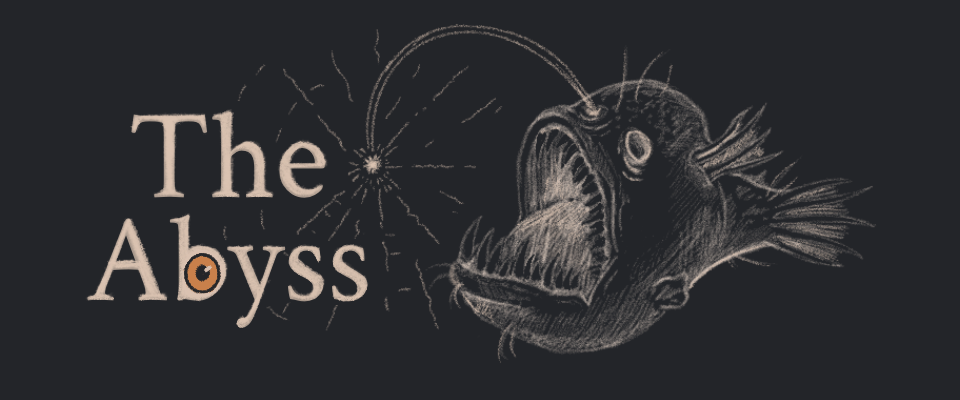

The Abyss is a **short 2D puzzle game made with Unity**, set in an underwater mansion that the player must explore to uncover its secrets and break free.

The game was developed by a team of six over a couple of weeks for [**the Confounding Calendar 2024**](https://confoundingcalendar.itch.io/).

I served as the **lead programmer, solo game and puzzle designer, and overall producer/director**.

The idea behind The Abyss was to create a **compact, single-level puzzle experience using a limited color palette**. This constraint led us to focus on a core mechanic built around color and puzzle design: light, and how what you see changes depending on its color.

My Contributions:
- **Puzzle Design**: Created and iterated on the game's main puzzle.
- **Main Mechanic**: Designed and implemented the core mechanic of room rearrangement.
- **Light Layers System**: Developed a system using light and layers to reveal rooms or elements based on the current light color. I experimented with both masking and spawning objects based on light overlap. Ideally, we would’ve used masks alone, but due to Unity’s limitations (or those of the version we used), I combined both: one mask to show elements within the light’s radius, and toggled color “layers” to hide or reveal parts of the mansion.
- **Player Movement**: Built a simple player controller for lateral movement, interaction, light switching, and stair climbing.
- **Game Manager**: Created and managed game logic, including a Game Manager to track progress, collected items, scene transitions, and more.
- **Support**: Assisted fellow programmers and artists with asset imports, mechanic implementation, bug fixes, and general troubleshooting.
- **UI Logic**: Handled UI logic for the main menu and credits.
- **Music and Sound**: Implemented the Sound Manager and added the music and sound effects.
- **Initial Shadow**: Built the darkness that follows the player and fades away when the first crystal is picked up.
- **Particle Systems**: Sparkles on crystals, keys and NPCs.
- **Project Setup**: Set up the project structure and the URP 2D lighting.

And more!

Once the game idea was locked in and the art team proposed the visual style, I sketched the first version of the puzzle and suggested an additional mechanic to deepen the gameplay: the ability to rearrange the rooms of the mansion. This would require players to think not just about what light they were using, but also how the room order affected their progression.

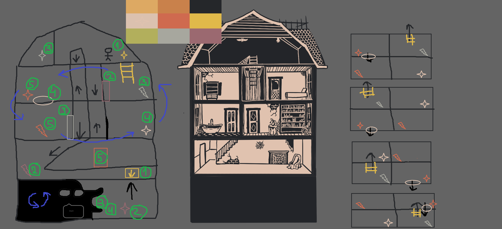{: full}

I felt this mechanic added meaningful depth beyond just collecting colored crystals. It pushed players to consider how each light color revealed different elements in each room—and how those elements changed when the layout shifted. For example, a hole might only appear under orange light in one room, and after rearranging the mansion, that same hole could let the player drop into a previously inaccessible area.

I designed the puzzle to introduce mechanics gradually, helping players understand each step as they went. Ideally, the player goes through the following stages:

 1- **Unawareness**: The player begins as a small fish in darkness with only basic controls. They appear at the far left of the attic and naturally move right.
 2- **Light**: In the dark, the only visible object is a glowing crystal on the right side of the attic. Getting close shows an “E” prompt. Picking it up activates the light, pushing back the darkness and revealing the mansion.
 3- **Stairs**: With light now revealing floors and surroundings, moving back shows a staircase matching the crystal’s color. Players instinctively descend, learning how stairs work.
 4- **Locked Door**: A few floors down, they encounter a door of the same color as their crystal and an “E” prompt—but it won’t open. A locked sound plays, implying they need a key.
 5- **First Key**: Continuing to the living room, the player sees a skeleton behind the locked door—piquing curiosity. After exploring, they find a creature that gives them a key matching their current light color, allowing them to open the door.
 6- **Second Crystal**: Inside the newly opened room, the skeleton gives them a second crystal. Equipping it changes the light color, revealing a previously hidden ladder that leads to a new room.
 7- **Crystal Swapping**: In this new room, they find a second key matching the new light color. But returning to the earlier door, they notice it’s now invisible—reinforcing the need to swap between crystals.
 (Note: I originally designed this crystal to be pink to better differentiate it from the first. The art team later changed the color, but I believe pink would’ve better communicated the switch and emphasized the idea of interchangeability.)
 8- **Room Movement**: Back in the living room, the new crystal grants access to a trapdoor to the basement, where a mysterious creature awaits. This character sets the tone and introduces the room rearrangement mechanic. After a short dialogue, the player is asked if they want to rearrange the house. Saying yes triggers an animation of rooms rotating counterclockwise. When gameplay resumes, the layout has changed.
 9- **Eureka Moment**: Exploring again, the player realizes that not only have the rooms moved, but also their internal elements—like doors and ladders. Ideally, they notice the ladder that led to the second crystal room now connects to the attic above the skeleton room.
 10- **Game Mastery**: At this point, all core mechanics are introduced. The player can now fully engage with the puzzle by rotating rooms and switching lights to solve the mystery and escape the mansion. Even if they don’t fully grasp the mechanics, brute-forcing a solution is still possible—but it’ll take longer.

Too scared to play? Here is the game in action (captured from the real game, not mockups):

**Crossing the dark attic to reach the first crystal**

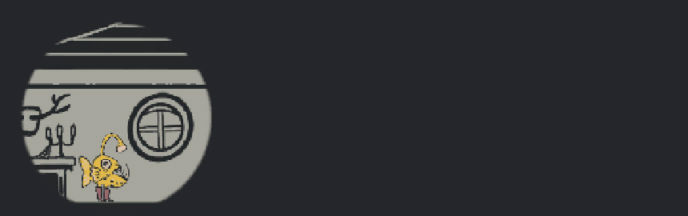

**The crystal's light pushes back the darkness and reveals the mansion**

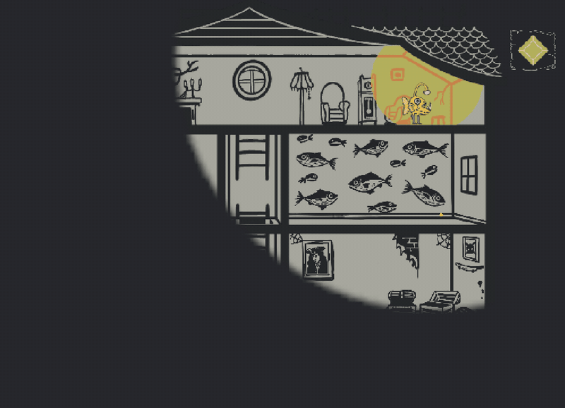

**Switching between crystals changes which rooms and objects you can see**

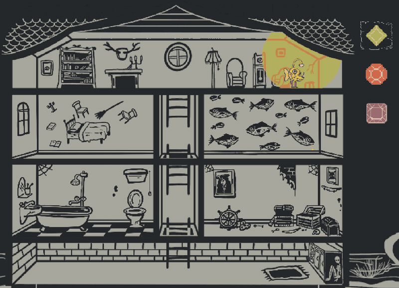

**The skeleton hands you a new crystal**

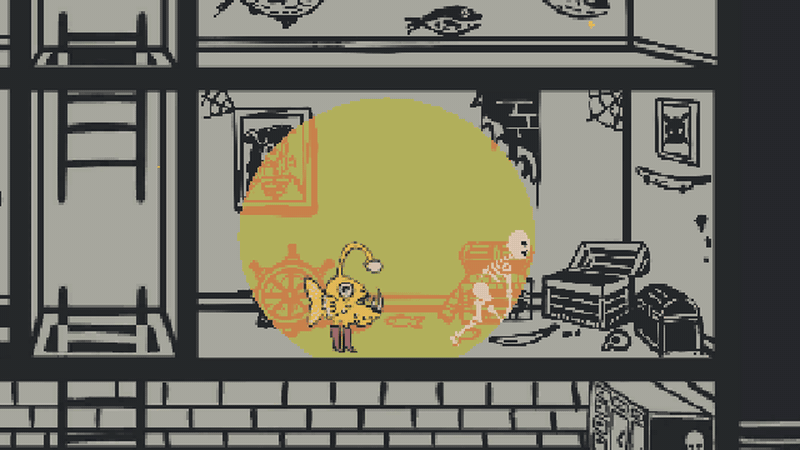

**Using the ladders to move between the floors of the mansion**

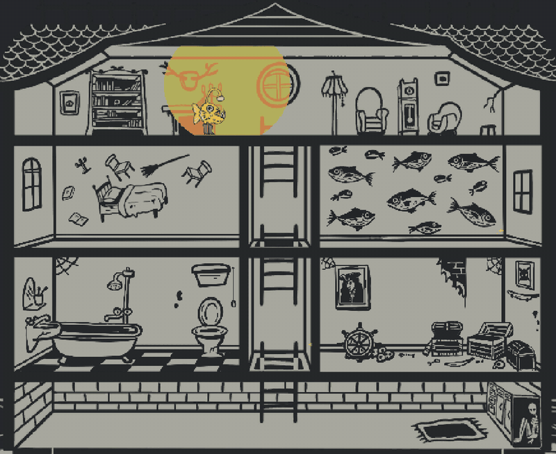

**A key opens the trapdoor, which leads down to the basement**

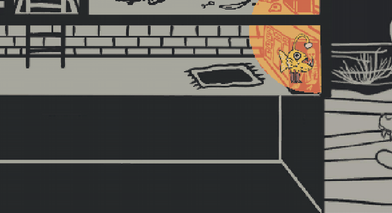

**The creature in the basement offers to reshape the house**

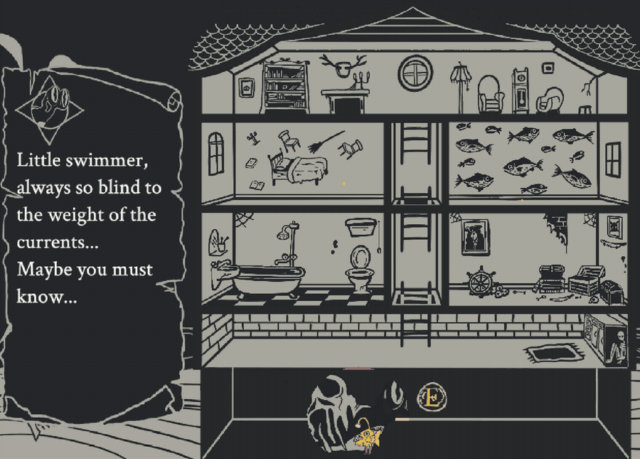

**The rooms swap places, changing the mansion's layout**

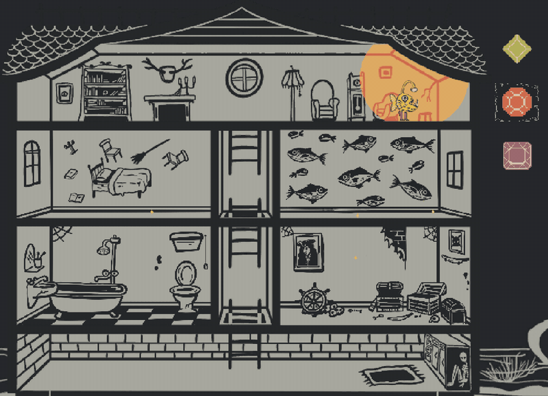

**Escaping the mansion: the ending sequence (spoiler!)**

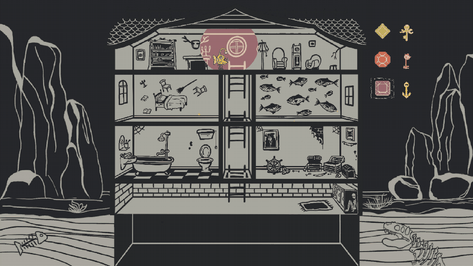

And some screenshots:


